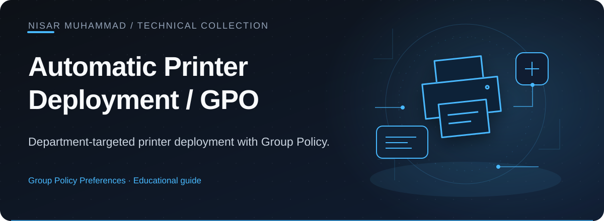

# Automatic Printer Deployment Using GPO

<picture>
  <source media="(max-width: 640px)" srcset="Assets/portfolio/hero-mobile.svg" />
  
</picture>

**[Download the Illustrated Beginner's Step-by-Step Guide (PDF)](https://github.com/nisarnis-prog/Automatic-Printer-Deployment-GPO/releases/download/v1.1.0/Automatic-Printer-Deployment-Guide.pdf)** · [View the repository copy](Documentation/Automatic-Printer-Deployment-Guide.pdf) · [Start here](START-HERE.md)

Deploy a shared network printer to domain users with Active Directory Group Policy Preferences. The guide follows the Automatic Printer Installation GPO Reel and walks through server setup, department targeting, a pilot migration, and rollback. Deployment is configured in Windows consoles and requires no PowerShell scripts.

## What the guide covers

- Share a network printer, confirm access, and select approved drivers.
- Assign queues to department security groups with item-level targeting.
- Enable an optional default printer, validate a pilot, and explicitly remove a retired connection.
- Diagnose policy and print failures, restore the old queue, and reverse the migration when needed.

## Prerequisites and environment

The example uses an Active Directory domain, domain-joined Windows 11 clients, a Windows Print Server, GPMC, network printer access, delegated administrative permissions, and trusted signed drivers. Console labels can vary by Windows version. The domain, server, groups and queues are fictional. The illustrations recreate selected UI fields.

The procedure was checked against Microsoft documentation. A live AD rollout, driver staging, test printing and rollback were not independently lab-tested for this guide.

## Safety precautions

Obtain authorization, inventory the existing queues, back up affected GPOs, and plan rollback. Test with standard user accounts in a controlled pilot before removing an old queue. Keep Point and Print protections and administrator driver-installation requirements in place. Have IT stage trusted drivers through approved administrative tooling where required.

## User responsibilities

Administrators are responsible for authorization, environment compatibility, permissions, backups, change control, pilot verification, rollback, and compliance with organizational policies. Protect policy reports and other configuration information.

## Disclaimer and limitation of liability

This guide is provided as is, without warranty. To the extent permitted by applicable law, the author is not liable for loss or disruption arising from use. Review the [license terms](LICENSE).

## License

Copyright © 2026 Nisar Muhammad. The original educational documentation and illustrations are licensed under [CC BY 4.0](https://creativecommons.org/licenses/by/4.0/). Microsoft products, trademarks and third-party materials are outside that grant. [Full license text](LICENSE)

## Microsoft references

- [Group Policy preferences](https://learn.microsoft.com/en-us/windows-server/identity/ad-ds/manage/group-policy/group-policy-preferences)
- [Shared Printer preference actions](https://learn.microsoft.com/en-us/openspecs/windows_protocols/ms-gppref/25933884-5e21-4700-a3e3-a0ed56463c28)
- [Group Policy processing](https://learn.microsoft.com/en-us/windows-server/identity/ad-ds/manage/group-policy/group-policy-processing)
- [Point and Print driver-installation requirements](https://support.microsoft.com/en-us/servicing/os/windows/2021/08/kb5005652-manage-new-point-and-print-default-driver-installation-behavior-cve-2021-34481)
- [gpupdate](https://learn.microsoft.com/en-us/windows-server/administration/windows-commands/gpupdate) and [gpresult](https://learn.microsoft.com/en-us/windows-server/administration/windows-commands/gpresult)

**Prepared by Nisar Muhammad**  
Instagram: [@nisarmohammed](https://www.instagram.com/nisarmohammed/)  
GitHub: [nisarnis-prog](https://github.com/nisarnis-prog)

